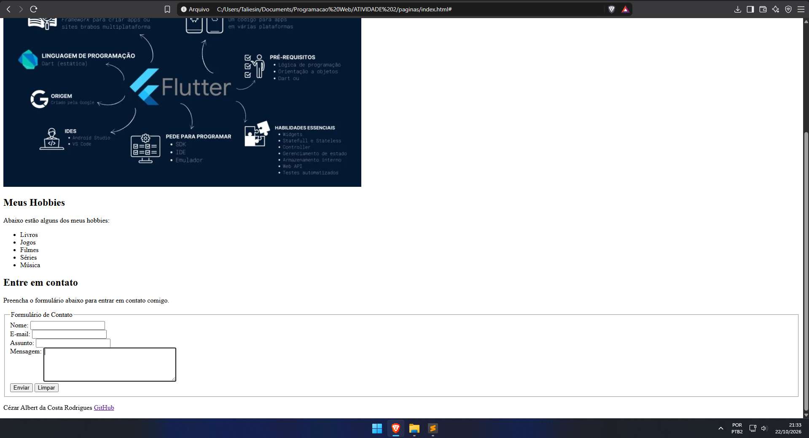

# Atividades Práticas — Programação Web I

## Conceito

Atividades práticas da disciplina de Programação Web I, com foco na estrutura básica do HTML5, na utilização de suas principais tags e na criação de formulários.

## Objetivo

Desenvolver uma página pessoal utilizando HTML5, aplicando conceitos fundamentais de estruturação de conteúdo, títulos, parágrafos, imagens, links, navegação entre páginas e formulários.

## Atividades desenvolvidas

### Atividade 2 — Página Pessoal

Desenvolvimento de uma página pessoal utilizando elementos semânticos do HTML5, contendo informações pessoais, hobbies, imagens e links para páginas internas e externas.

### Atividade 3 — Formulário de Contato

Implementação de um formulário de contato na página pessoal desenvolvida anteriormente, utilizando elementos HTML para entrada de dados, como campos de texto, e-mail e área de mensagem.

### Atividade 4 — Estilização com CSS

Aplicação de estilos CSS às páginas desenvolvidas nas atividades anteriores, utilizando seletores, classes, propriedades de cores, fontes, espaçamentos, bordas e alinhamentos para melhorar a aparência e a organização visual do conteúdo.

## Estrutura do projeto

- `ATIVIDADE 2/` — pasta contendo as subpastas `paginas/`, com os arquivos HTML, e `img/`, com as imagens utilizadas.
- `Atividade 2 - Página Pessoal.pdf` — documento com o enunciado da Atividade 2.
- `Atividade - Formulário de contato.pdf` — documento com o enunciado da Atividade 3.
- `Atividade 4 - CSS.pdf` — documento com o enunciado da Atividade 4 (ajustar conforme o nome real do arquivo).
- `style.css` — arquivo responsável pela estilização das páginas HTML.

## Tecnologias utilizadas

- **HTML5** — estruturação e organização do conteúdo das páginas.
- **CSS3** — estilização e apresentação visual dos elementos HTML.

## Contexto acadêmico

- **Curso:** Técnico em Informática para Internet
- **Disciplina:** Programação Web I
- **Professor:** Fábio Ferreira
- **Instituição:** Instituto Federal do Sudeste de Minas Gerais (IF Sudeste MG)

## Captura de tela formulário

## Capturas de tela — Atividade 4 CSS

